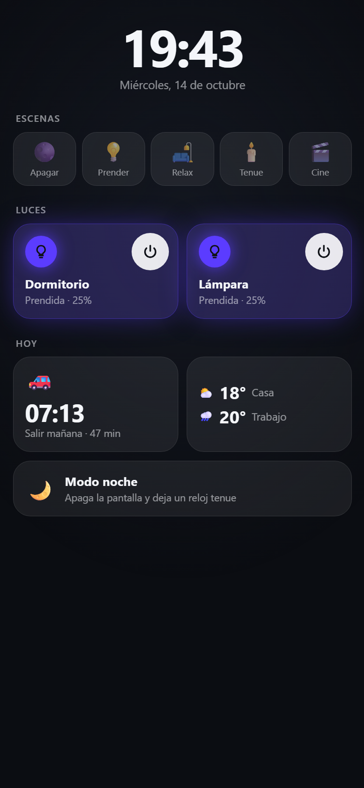
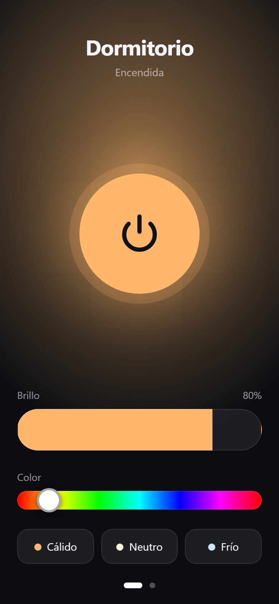
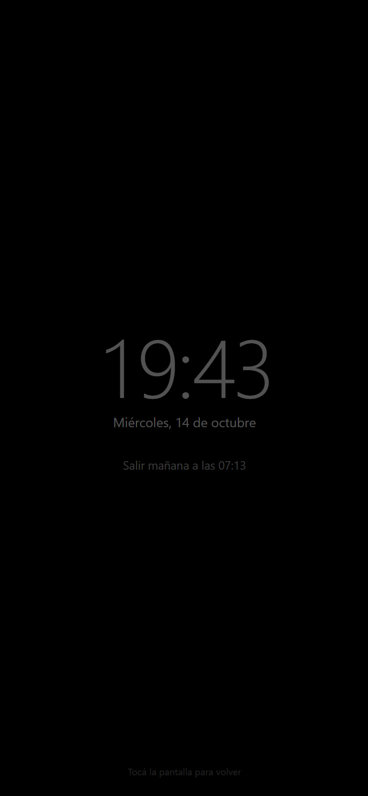
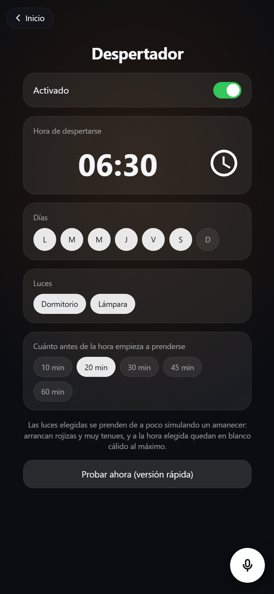
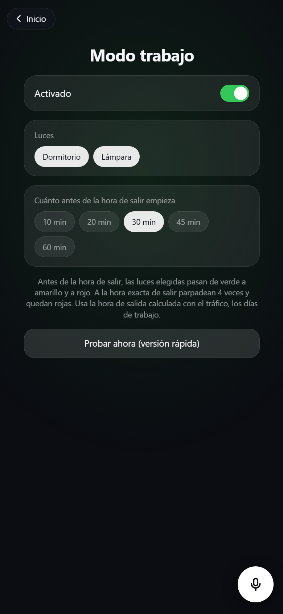
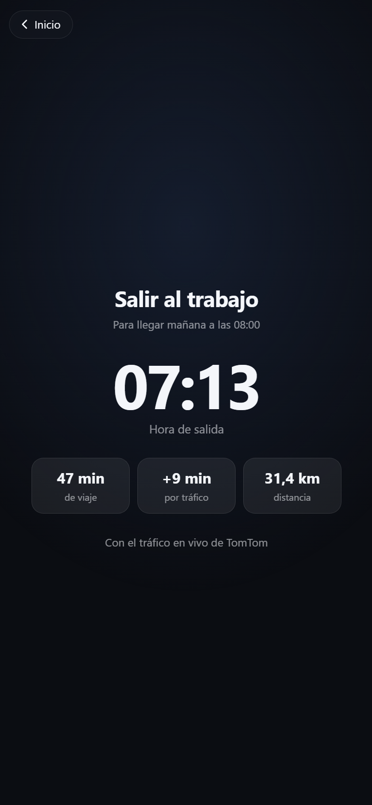
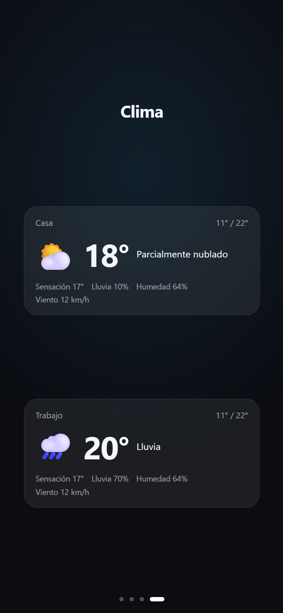

# panel-luces

Panel web táctil para la casa: controla luces **Tuya / Smart Life** por la red local (sin la app oficial y sin pasar por la nube), dice a qué hora salir al trabajo según el tráfico y muestra el clima. Pensado para correr en un celular Android viejo (con Termux) y dejarlo como panel fijo en la pared.

<p align="center">
  
  
  
</p>

## Qué hace
- **Pantalla de inicio con mosaicos**: reloj grande, escenas, una tarjeta por luz y tarjetas de viaje y clima. Tocar una tarjeta abre su pantalla completa; "Inicio" (o el botón atrás de Android) vuelve. Si nadie toca nada por 2 minutos, vuelve sola al inicio.
- **Escenas** para todas las luces juntas: Apagar, Prender, Relax, Tenue y Cine (se cambian en `ESCENAS`, dentro de `web/index.html`).
- **Tarjeta de cada luz**: se tiñe con el color de la luz cuando está prendida; el botón de la esquina la prende o apaga sin entrar.
- **Pantalla de cada luz**: botón de encendido grande que brilla con el color de la luz, brillo, color (arcoíris) y tres blancos (cálido, neutro, frío).
- **Modo noche**: pantalla negra con un reloj tenue y la hora de salida de mañana. Se activa desde su tarjeta o solo entre las 23:00 y las 6:30 si nadie toca la pantalla por 2 minutos (horario en `NOCHE_DESDE` / `NOCHE_HASTA`). Tocar la pantalla lo cierra.
- **Despertador**: las luces elegidas se prenden de a poco simulando un amanecer (de rojizo tenue a blanco cálido fuerte). Se eligen la hora, los días, las luces y cuántos minutos antes empieza.
- **Modo trabajo**: antes de la hora de salir, las luces elegidas pasan de verde a amarillo y a rojo; a la hora exacta parpadean 4 veces y quedan rojas.
- El despertador y el modo trabajo los ejecuta el servidor, así funcionan con la pantalla apagada. Se guardan en `ajustes.json` y cada uno tiene un botón "Probar" con una versión rápida.
- **Hablarle al panel**: botón de micrófono con comandos en español ("prendé la lámpara", "apagá todo", "escena cine", "brillo al 50", "luz azul", "¿a qué hora salgo?", "¿cómo está el clima?", "despertador a las 6 y media", "modo noche"). Usa el reconocimiento de voz de Chrome, que necesita internet.
- **A qué hora salir** para llegar al trabajo (por defecto a las 8:00, de lunes a sábado) según el tráfico en vivo, y el **clima** en casa y en el trabajo.
- Se instala como app a pantalla completa y pide que la pantalla no se apague.
- Si una luz no responde, la muestra "Sin conexión" y sigue reintentando.
- Modo `--demo` con luces y datos simulados, para probarlo sin hardware.

## Rutinas
<p align="center">
  
  
</p>

## Viaje al trabajo y clima
<p align="center">
  
  
</p>

Copiar `lugares.example.json` como `lugares.json` y completar:
- `casa` y `trabajo`: la `direccion` (se busca una sola vez en OpenStreetMap) o directamente `lat` y `lon`.
- `llegada`: hora a la que querés llegar (`"08:00"`) y `dias_laborales` (1 = lunes … 7 = domingo).
- `tomtom_key`: clave gratis de [developer.tomtom.com](https://developer.tomtom.com) (2.500 consultas por día, el panel usa unas 300). Se usa para calcular la hora de salida con tráfico.

El clima sale de [Open-Meteo](https://open-meteo.com), que es gratis y no necesita clave. `lugares.json` está en el `.gitignore` porque tiene tus direcciones.

## Cómo funciona
- `server.py`: servidor HTTP en Python (solo librería estándar) que habla con las luces por LAN con [TinyTuya](https://github.com/jasonacox/tinytuya) y expone una API chica:
  - `GET /api/luces`: estado de todas las luces.
  - `POST /api/luces/<id>`: cambia `encendida`, `brillo` (1-100), `color` (`#rrggbb`) o `blanco` (0 cálido - 100 frío).
  - `GET /api/viaje`: hora de salida, minutos de viaje y demora por tráfico.
  - `GET /api/clima`: clima actual y del día en casa y en el trabajo.
  - `GET /api/ajustes` y `POST /api/ajustes`: ajustes del despertador y del modo trabajo.
  - `POST /api/probar/despertador` y `POST /api/probar/trabajo`: versión rápida para ver cómo queda.
- `web/`: la página del panel (HTML, CSS y JS sin dependencias ni paso de compilación).

## Probarlo sin luces
```bash
python server.py --demo
```
Abrir `http://localhost:8080`.

## Usarlo con luces reales
1. Tener las luces emparejadas en Smart Life y una cuenta gratis en [iot.tuya.com](https://iot.tuya.com) con un proyecto Cloud vinculado a esa cuenta de Smart Life.
2. Instalar TinyTuya y generar las claves locales (se necesita una sola vez):
   ```bash
   pip install tinytuya
   python -m tinytuya wizard
   ```
   Esto crea `devices.json` con el nombre, ID y clave local de cada luz.
3. Estando en el mismo WiFi que las luces, buscar su IP y versión de protocolo:
   ```bash
   python -m tinytuya scan
   ```
   y agregar `"ip"` y `"version"` a cada entrada de `devices.json` (ver `devices.example.json`).
4. Arrancar:
   ```bash
   python server.py
   ```

## En un celular Android (Termux)
1. Instalar Termux desde F-Droid o los releases de GitHub (no la versión de Play Store).
2. `pkg install python python-cryptography` y `pip install tinytuya`.
3. Copiar esta carpeta (con tu `devices.json`) al celular y correr `sh iniciar.sh`.
4. Abrir `http://localhost:8080` en Chrome e instalarlo como app (menú → Instalar app).
5. Para que arranque solo al prender el celular, usar [Termux:Boot](https://github.com/termux/termux-boot) con un script en `~/.termux/boot/` que ejecute `iniciar.sh`.

## Seguridad
`devices.json` contiene las **claves locales** de tus luces y `tinytuya.json` las credenciales de tu cuenta de desarrollador de Tuya. Están en el `.gitignore`: no los subas ni los compartas. El servidor no tiene autenticación, así que usalo solo dentro de tu red de confianza.

## Aclaración
Proyecto personal, hecho a medida para unas luces concretas. No está afiliado a Tuya ni a Smart Life.

## Licencia
[MIT](LICENSE) © 2026 Nahuel Corsi
